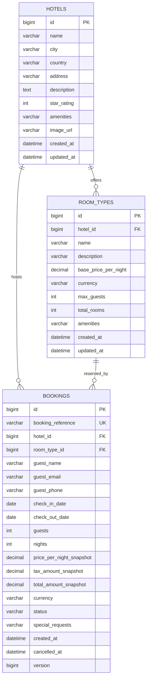

# Architecture & System Design — Hotel Booking Portal

## 1. Architectural Style: Scalable Modular Monolith

The system is structured as a **single deployable Modular Monolith** rather than microservices to avoid distributed transaction overhead, network serialization latency, and operational complexity while preserving strict module boundaries:

1. **Hotel Management (`com.hotelportal.hotel`)** — Property catalog, city filtering, pagination, sorting, and batch hotel-level availability summaries.
2. **Room Management (`com.hotelportal.room`)** — Room inventory definitions (`totalRooms`, `maxGuests`, `basePricePerNight`) and per-hotel room availability views.
3. **Availability Management (`com.hotelportal.availability`)** — Date-range validation, date-overlap capacity computation, and **Smart Alternative Dates** lookup.
4. **Pricing Management (`com.hotelportal.pricing`)** — Authoritative server-side nightly subtotal, tax computation, and rounding (`HALF_UP`).
5. **Booking Management (`com.hotelportal.booking`)** — Transactional reservation creation under pessimistic locking, unique reference generation, reference+email retrieval, and cancellation with capacity release.
6. **Common (`com.hotelportal.common`)** — Cross-cutting CORS configuration, uniform `ApiError` responses, `PageResponse<T>` pagination envelope, and `GlobalExceptionHandler`.

Each module follows a strict layered flow:
`Controller -> Service -> Repository -> Entity`, communicating through explicit DTOs and service interfaces rather than leaking JPA entities over HTTP.

---

## 2. Database Schema & Entity Relationships



### Key Modeling Decisions
- **Immutable Price Snapshots:** `bookings` stores `nights`, `price_per_night_snapshot`, `tax_amount_snapshot`, `total_amount_snapshot`, and `currency` at booking time. Updating `room_types.base_price_per_night` later will never alter historical bookings.
- **No Trust in Client Pricing:** `CreateBookingRequest` does not accept any price or total fields; `PricingService` always computes prices on the backend.
- **Status Lifecycle (`CONFIRMED` / `CANCELLED`):** Capacity is derived from active `CONFIRMED` bookings, so setting `status = CANCELLED` and `cancelled_at` atomically releases inventory without deleting audit history.

---

## 3. Database Indexing Strategy

Defined in `V1__create_schema.sql`:

| Table | Index Name | Columns | Purpose |
|---|---|---|---|
| `hotels` | `idx_hotels_city` | `(city)` | Accelerates city/location filtering |
| `hotels` | `idx_hotels_city_rating` | `(city, star_rating)` | Optimizes filtered + star-rating sorted search |
| `room_types` | `idx_room_types_hotel_guests` | `(hotel_id, max_guests)` | Fast lookup of hotel room types matching guest count |
| `bookings` | `uk_bookings_reference` | `(booking_reference)` | Unique constraint + O(log N) lookup on booking reference |
| `bookings` | `idx_bookings_room_status_dates` | `(room_type_id, status, check_in_date, check_out_date)` | Composite covering index for overlap capacity & 7-day alternative date scans |
| `bookings` | `idx_bookings_ref_email` | `(booking_reference, guest_email)` | Direct index lookup for guest booking retrieval & cancellation |
| `bookings` | `idx_bookings_hotel_status` | `(hotel_id, status)` | Supports hotel-level reporting and future analytics |

---

## 4. Core Date Overlap Rules

- **Check-in is inclusive**, **check-out is exclusive**: a stay occupies `[checkInDate, checkOutDate)`.
- Two stays `[A_in, A_out)` and `[B_in, B_out)` overlap if and only if:
  ```sql
  A.check_in_date < B_out AND A.check_out_date > B_in
  ```
- **Back-to-back stays are allowed:** if Booking A ends on `2026-12-10` and Booking B starts on `2026-12-10`, `A_out > B_in` (`2026-12-10 > 2026-12-10`) evaluates to `false`, so no conflict is counted.
- **Cancelled bookings release capacity:** all availability queries filter by `status = 'CONFIRMED'`.

---

## 5. Booking Concurrency Strategy (Pessimistic Locking)

A naive "check count, then insert" pattern suffers from a race condition (phantom overbooking): two concurrent transactions can both observe `overlapping = totalRooms - 1` and both insert a new `CONFIRMED` row.

### Why Locking `bookings` Alone Is Not Enough
Row locks on existing `bookings` rows do not stop two concurrent transactions from inserting *new* rows when zero or fewer than `totalRooms` rows exist.

### Solution Implemented in `BookingService.createBooking`
1. Annotate `createBooking` with `@Transactional` (`READ_COMMITTED` / InnoDB default).
2. Acquire a **pessimistic write lock (`SELECT ... FOR UPDATE`)** on the parent `room_types` row via `RoomTypeRepository.findByIdWithHotelForUpdate(roomTypeId)` (`@Lock(LockModeType.PESSIMISTIC_WRITE)`).
3. Because every booking for a given `room_type_id` must acquire the row lock on that `room_types` record in MySQL/InnoDB, concurrent requests for the **same room type** are strictly serialized at the database level (while bookings for different room types execute in parallel with zero contention).
4. Inside the lock, `BookingService` re-counts overlapping `CONFIRMED` bookings. If `overlapping >= totalRooms`, it throws `RoomUnavailableException` (`409 Conflict`) and rolls back cleanly.
5. As defense-in-depth, `bookings` includes `@Version` optimistic locking for concurrent updates to the same booking record, and `findByReferenceAndEmailForUpdate` locks the booking row during cancellation.

Verified by `BookingPortalIntegrationTest.concurrentBookingsRespectRoomCapacityUnderPessimisticLock` (8 concurrent threads competing for `totalRooms = 2` -> exactly 2 `CONFIRMED`, 6 rejected with `RoomUnavailableException`).

---

## 6. Smart Alternative Dates Algorithm

When a room type fits `guests <= maxGuests` but has `availableRooms == 0` for `[checkIn, checkOut)` (`nights = checkOut - checkIn`):

1. **Single-Query Window Scan:** Instead of running 7 separate queries, `AvailabilityService` executes **one** query (`findOverlappingBookingsInWindow`) across `[checkIn + 1, checkIn + 7 + nights)` for all sold-out eligible room types in the hotel.
2. **Sliding Window Evaluation:** For `offset = 1..7`, it constructs `[checkIn + offset, checkIn + offset + nights)`, preserving the exact requested stay length.
3. **Capacity Check & Pricing:** Using the in-memory list of confirmed bookings for that room type, it counts overlaps in `O(B)` and computes the backend `PriceBreakdown` whenever `totalRooms - overlapping > 0`.
4. **Top-3 Cap:** Returns up to **3** earliest available windows, displayed as one-click suggestions in `HotelDetailComponent`.

---

## 7. Scalability & Future Readiness

- **Stateless REST APIs:** Zero HTTP session state; any number of Spring Boot instances can sit behind a load balancer.
- **Database-Backed Serialization:** Because `SELECT ... FOR UPDATE` lives in MySQL rather than in-JVM `synchronized` locks, concurrency safety holds across horizontally scaled application instances.
- **Zero N+1 Read Paths:** `HotelService` and `RoomService` batch-fetch room types (`findByHotelIdIn`), overlapping counts (`GROUP BY room_type_id`), and alternative-date windows in constant query counts per request.
- **HikariCP & `open-in-view: false`:** Bounded connection pool (`HotelBookingHikariPool`, default max 20) and disabled OSIV ensure DB connections are held only for the duration of active transactions.
- **Redis Caching Readiness:** `HotelService.getHotelById`, `HotelRepository.findDistinctCities`, and `RoomType` metadata are pure read-mostly lookups cleanly isolated behind service boundaries, allowing `@Cacheable` / Redis cache-aside integration without altering controllers or entities.
