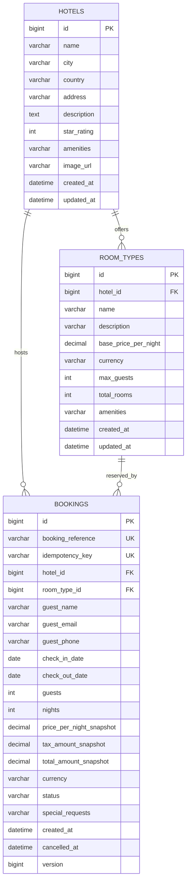

# Architecture & System Design — StayAtlas Hotel Booking Portal

## 1. Architecture and Component Interactions

StayAtlas is built as a **Scalable Modular Monolith** rather than microservices to avoid distributed transaction overhead while keeping clear domain boundaries.

```text
Angular 19 SPA (Lazy-Loaded Features: HotelSearch, HotelDetail, ManageBooking, InfoPage)
        │  Stateless HTTP/JSON (CORS, Idempotency-Key)
        ▼
Spring Boot 3 REST Controllers (/api/hotels, /api/availability, /api/bookings, /api/health)
        │
        ├── Hotel Module        (HotelService, HotelRepository)
        ├── Room Module         (RoomService, RoomTypeRepository)
        ├── Availability Module (AvailabilityService, overlap math + Smart Alternative Dates)
        ├── Pricing Module      (PricingService, BigDecimal INR + 12% GST)
        └── Booking Module      (BookingService, BookingRepository, BookingReferenceGenerator)
                │
                ▼
        HikariCP Pool -> MySQL / MariaDB (InnoDB + Flyway V1–V4)
```

Each module follows `Controller -> Service -> Repository -> Entity` and exchanges immutable DTOs (`record` types), keeping JPA entities internal and `spring.jpa.open-in-view=false`.

---

## 2. Database Entities and Relationships



### Key Indexes (Defined in `V1__create_schema.sql` & `V4__add_booking_idempotency_key.sql`)
- `idx_hotels_city (city)` and `idx_hotels_city_rating (city, star_rating)`
- `idx_room_types_hotel_guests (hotel_id, max_guests)`
- `uk_bookings_reference (booking_reference)` and `uk_bookings_idempotency_key (idempotency_key)`
- `idx_bookings_room_status_dates (room_type_id, status, check_in_date, check_out_date)`
- `idx_bookings_ref_email (booking_reference, guest_email)`
- `idx_bookings_hotel_status (hotel_id, status)`

---

## 3. Main REST API Endpoints

- `GET /api/health` — Executes `SELECT 1` against HikariCP `DataSource` and reports `UP`/`CONNECTED` or `503` `DOWN`.
- `GET /api/hotels` — Paginated, sorted search supporting `location`/`city`, `checkIn`, `checkOut`, `guests`, `page`, `size`, `sortBy`, `direction`, `sort`.
- `GET /api/hotels/{id}` — Returns `HotelDetailResponse` (`404` if invalid ID).
- `GET /api/hotels/{id}/availability` — Validates dates and returns `HotelAvailabilityResponse` with per-room availability and INR `PriceBreakdown`.
- `GET /api/hotels/{id}/rooms` — Returns room categories with live availability and Smart Alternative Dates.
- `GET /api/availability/alternatives` — Returns up to 3 alternative date ranges within the next 7 days.
- `POST /api/bookings` — Creates a booking under pessimistic locking with `Idempotency-Key` support.
- `GET /api/bookings/{reference}?email=` (and `/lookup`) — Retrieves booking by reference + case-insensitive email.
- `PATCH /api/bookings/{reference}/cancel` (and `POST`) — Cancels `CONFIRMED` bookings and releases capacity.

---

## 4. Booking and Pricing Logic

1. **Zero Client Trust:** `CreateBookingRequest` carries no price fields. `PricingService` reads `RoomType.basePricePerNight` (`INR`) from MySQL.
2. **Calculation:**
   - `nights = ChronoUnit.DAYS.between(checkIn, checkOut)`
   - `subtotal = basePricePerNight * nights` (scale 2, `HALF_UP`)
   - `taxAmount = subtotal * 0.12` (12% GST, configurable via `APP_TAX_RATE`)
   - `totalAmount = subtotal + taxAmount`
3. **Immutable Snapshots:** `bookings` persists `price_per_night_snapshot`, `tax_amount_snapshot`, `total_amount_snapshot`, and `currency` so future tariff updates never mutate existing reservations.
4. **Reference Generation:** `BookingReferenceGenerator` uses `SecureRandom` over an unambiguous 32-character alphabet (`HTL-XXXXXXXX`) backed by `uk_bookings_reference`.

---

## 5. Date Overlap Calculations

- **Check-in is inclusive; check-out is exclusive:** A reservation occupies `[checkInDate, checkOutDate)`.
- **Overlap predicate:**
  ```sql
  b.check_in_date < :requestedCheckOut
  AND b.check_out_date > :requestedCheckIn
  AND b.status = 'CONFIRMED'
  ```
- **Back-to-back stays:** When Booking A ends on `2026-12-10` and Booking B starts on `2026-12-10`, `2026-12-10 > 2026-12-10` is `false`, so back-to-back stays are permitted.
- **Cancellation release:** Setting `status = CANCELLED` excludes the row from `CONFIRMED` overlap counts, immediately restoring `availableRooms = totalRooms - overlappingConfirmed`.

---

## 6. Simultaneous Booking Protection

### Pessimistic Locking & InnoDB `READ_COMMITTED`
1. `BookingService.createBookingWithIdempotency` and `cancelBooking` run inside `@Transactional(isolation = Isolation.READ_COMMITTED)`.
2. **Why `READ_COMMITTED` + Lock-First Ordering Matters in MySQL/InnoDB:** MySQL/MariaDB defaults to `REPEATABLE_READ`, where any `SELECT` before acquiring a row lock pins an MVCC snapshot for the whole transaction; subsequent non-locking `COUNT(*)` reads would miss rows committed by earlier concurrent transactions. By acquiring `SELECT ... FOR UPDATE` on `room_types` **first** under `READ_COMMITTED`, every waiting thread reads the latest committed `bookings` rows immediately after acquiring the `RoomType` lock.
3. **Consistent Lock Order:** Both `createBooking` and `cancelBooking` lock `RoomType` before accessing/locking `Booking`, preventing deadlocks.
4. **Idempotency:** `Idempotency-Key` is checked inside the `RoomType` lock and enforced at the database level by `uk_bookings_idempotency_key`.
5. **Verified on Real MySQL:** A 10-thread concurrent `POST /api/bookings` test against live MySQL/MariaDB (`localhost:3306`) on a `totalRooms = 1` suite produced **1** `201 Created` and **9** `409 Conflict`.

---

## 7. Design Alternatives and Trade-Offs

| Decision | Alternative | Trade-Off & Rationale |
|---|---|---|
| **Modular Monolith** | Microservices | Avoids distributed transactions / Saga complexity for tightly coupled inventory and booking state while preserving clean module boundaries. |
| **Pessimistic Write Lock on `RoomType`** | Optimistic Locking (`@Version`) or Locking `bookings` rows | Optimistic locking fails with high retry rates under contention; locking `bookings` rows cannot prevent phantom inserts when `0` rows exist. Locking the parent `RoomType` serializes per-room-type contention cleanly in MySQL. |
| **Derived Availability (`COUNT` on `bookings`)** | Pre-materialized `room_inventory_by_date` table | Derived queries eliminate drift between bookings and inventory tables and simplify cancellations; an indexed composite scan is fast at portal scale. |

---

## 8. Smart Alternative Dates Feature

When a room type supports `guests <= maxGuests` but `availableRooms == 0`:
1. `AvailabilityService.findAlternativeDateRanges` runs **one** batch query (`findOverlappingBookingsInWindow`) across `[checkIn + 1, checkIn + 7 + nights)` for all sold-out room types in the hotel.
2. It evaluates `offset = 1..7` in memory, preserving `nights`, counting overlaps per window, computing backend INR `PriceBreakdown`, and returning up to **3** available ranges.

---

## 9. Scalability Approach

- **Stateless REST APIs:** Enables horizontal scaling behind a load balancer; DB row locks serialize contention across all backend instances.
- **Zero N+1 Read Paths:** `HotelService` and `RoomService` batch-fetch room types (`IN`), overlap counts (`GROUP BY`), and alternative windows.
- **HikariCP & OSIV Disabled:** Bounded connection pool (`max=20`, `minIdle=5`) and `open-in-view=false`.
- **Frontend Lazy Loading:** Angular routes (`hotel-search`, `hotel-detail`, `manage-booking`, `info-page`) load on demand.

---

## 10. Limitations and Future Improvements

- Add Redis cache-aside for read-mostly hotel/city catalog queries (`@Cacheable`) when read volume grows.
- Add guest authentication (OAuth2/OTP) and email notifications on confirmation/cancellation.
- Add payment gateway integration (e.g., Razorpay/Stripe) with two-phase hold/expiration (`PENDING_PAYMENT` TTL).
- Add pre-aggregated daily inventory counters if booking table volume scales into millions of active rows per property.
