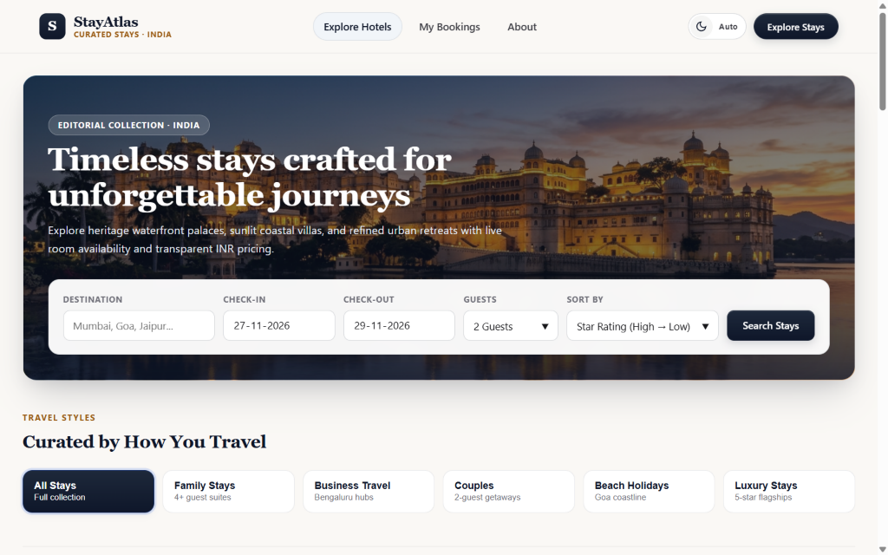
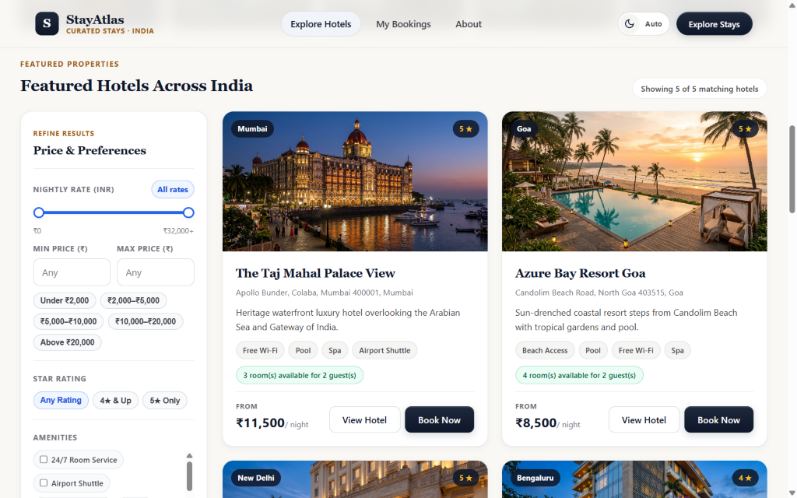
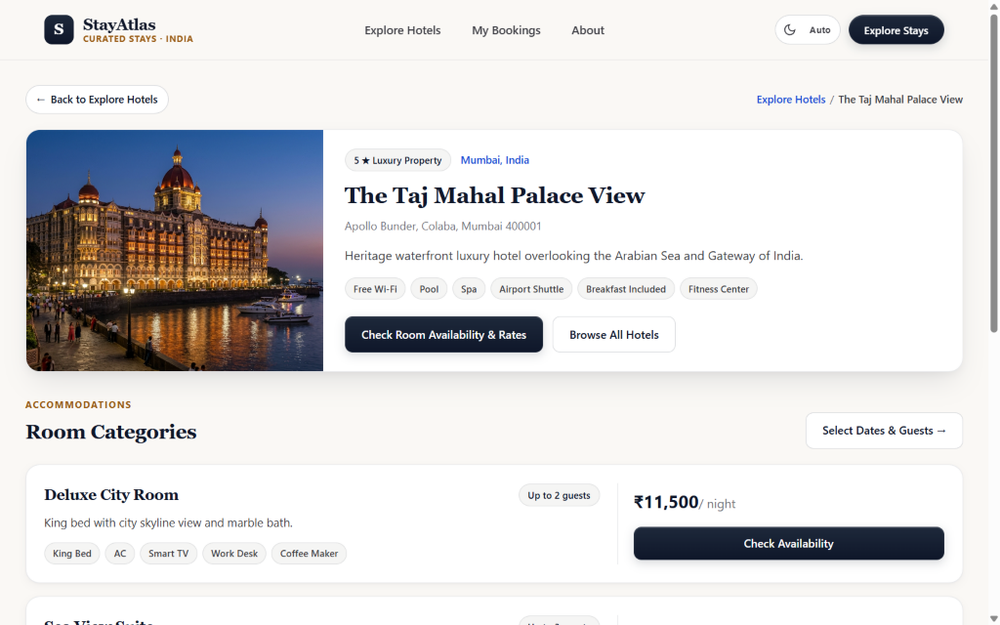
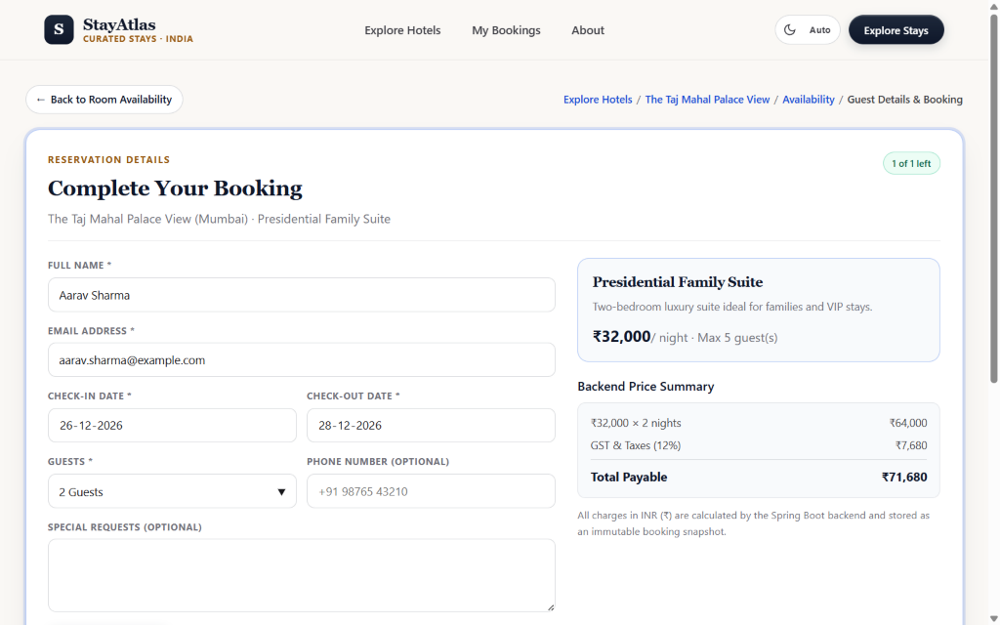
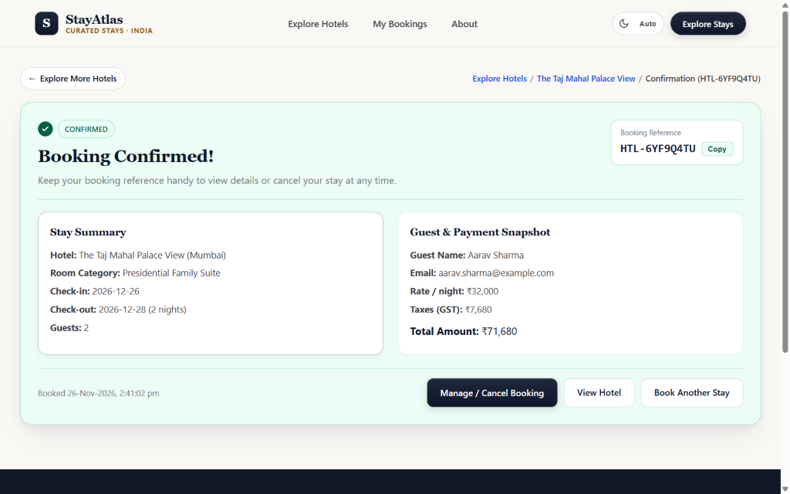
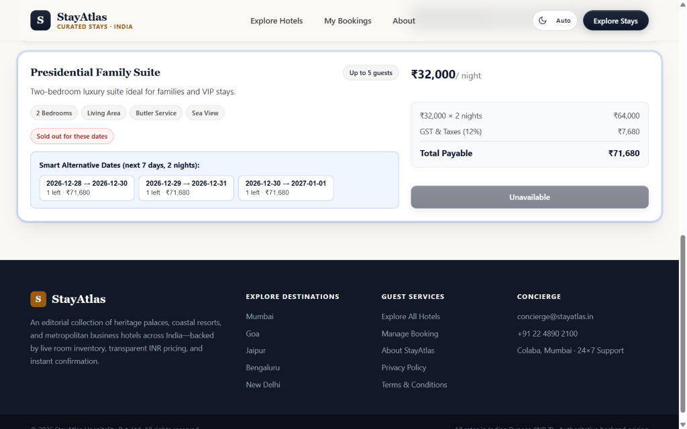
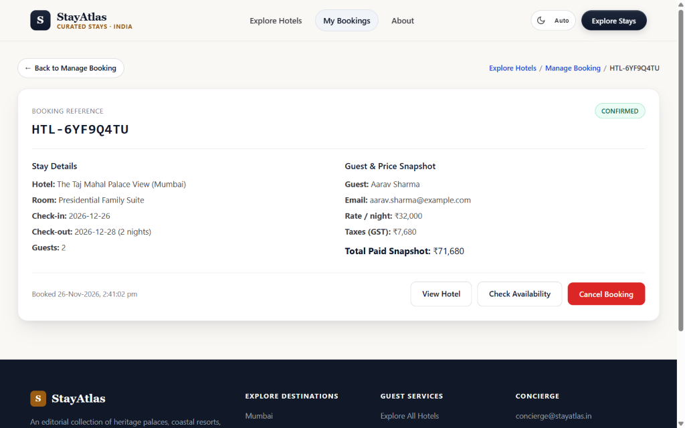
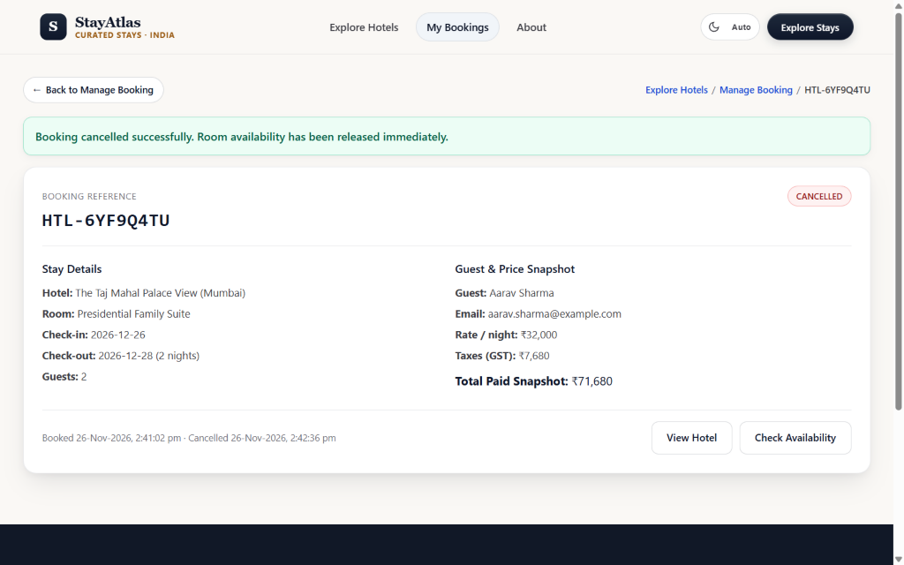

# StayAtlas — Hotel Booking Portal

**StayAtlas** is a full-stack **Hotel Booking Portal** built as a **Scalable Modular Monolith** with **Java 21, Spring Boot 3, Spring Data JPA, Flyway, MySQL, and Angular 19**. It delivers real-time room availability checks, authoritative backend INR (`₹`) pricing, transaction-safe reservation creation with pessimistic row locking, idempotent booking retries, guest booking retrieval and cancellation, and a **Smart Alternative Dates** recommendation engine.

---

## Screenshots

| Homepage & Hero Search | Hotel Listing |
|---|---|
|  |  |

| Hotel Details & Room Categories | Reactive Booking Form |
|---|---|
|  |  |

| Booking Confirmation | Smart Alternative Dates |
|---|---|
|  |  |

| Manage Booking | Cancellation & Capacity Release |
|---|---|
|  |  |

---

## Key Features

- **5 Curated Indian Hotels & 11 Room Categories:** Seeded automatically via Flyway across Mumbai, Goa, Jaipur, Bengaluru, and New Delhi.
- **Database-Level Search & Advanced Filters:** Filter at the MySQL/JPA layer by location, check-in/check-out dates, guest capacity, **Min/Max room price per night** (`minPrice`/`maxPrice` with synchronized dual slider, manual inputs, and quick presets), minimum star rating, and multiple hotel amenities, combined with sorting and pagination.
- **Dedicated Multi-Page Angular Routes:** Separate bookmarkable/refresh-safe routes for `/hotels`, `/hotels/:id`, `/hotels/:id/availability`, `/booking/:hotelId/:roomTypeId`, `/booking/confirmation/:reference`, `/manage-booking`, and `/manage-booking/:reference`, with breadcrumbs and Back navigation.
- **Light, Dark & System Themes:** Flicker-free pre-render theme initialization with `localStorage` persistence and accessible desktop/mobile theme switchers.
- **Date Validation & Exclusive Check-Out Overlap Math:** Rejects past check-in dates and `checkOut <= checkIn`; allows back-to-back stays (`checkIn2 == checkOut1`).
- **Authoritative Backend INR (`₹`) Pricing:** Computes `nights * basePricePerNight + 12% GST` using `BigDecimal` on the backend and persists immutable price snapshots on every booking.
- **Concurrency-Safe Reservations:** Uses `@Transactional(isolation = Isolation.READ_COMMITTED)` + `PESSIMISTIC_WRITE` (`SELECT ... FOR UPDATE`) on the parent `RoomType` row to prevent double-booking the last room.
- **Idempotency-Key Support:** Protects against duplicate submissions on double-clicks or network retries via `Idempotency-Key` header and a unique DB constraint.
- **Booking Retrieval & Cancellation:** Guests look up reservations by `bookingReference` + `guestEmail` on `/manage-booking` and cancel `CONFIRMED` bookings on `/manage-booking/:reference` via an in-page confirmation step, immediately releasing room capacity.
- **Surprise Feature — Smart Alternative Dates:** When a room category is sold out for requested dates, automatically suggests up to 3 available date windows within the next 7 days preserving the exact stay duration.

---

## Technology Stack

- **Backend:** Java 21, Spring Boot 3.2.5, Spring Data JPA, Bean Validation, Flyway 9.22.3, HikariCP, Maven
- **Database:** MySQL 8.x / MariaDB 10.4+ (InnoDB) for runtime; H2 (MySQL mode) for isolated automated tests
- **Frontend:** Angular 19 (Standalone Components, Lazy-Loaded Routes, Reactive Forms, HttpClient, TypeScript, SCSS)
- **Testing:** JUnit 5, Mockito, Spring MockMvc, Karma + Jasmine

---

## Architecture Overview

StayAtlas is structured as a **Modular Monolith** with strict package boundaries:
- `com.hotelportal.hotel` — Hotel catalog, search, pagination, sorting, and batch availability summaries.
- `com.hotelportal.room` — Room categories (`totalRooms`, `maxGuests`, `basePricePerNight`) and hotel availability views.
- `com.hotelportal.availability` — Date validation, overlap counting, and Smart Alternative Dates.
- `com.hotelportal.pricing` — Authoritative server-side `BigDecimal` pricing and GST calculation.
- `com.hotelportal.booking` — Pessimistic-locked reservation creation, `Idempotency-Key` handling, lookup, and cancellation.
- `com.hotelportal.common` — Health check (`/api/health`), CORS configuration, `PageResponse`, `ApiError`, and `GlobalExceptionHandler`.

For full architectural details, ER diagrams, concurrency rationale, and trade-offs, see [`DESIGN.md`](DESIGN.md).

---

## Prerequisites

- **Java:** JDK 21+
- **Maven:** 3.9+
- **Node.js:** 20+ (tested with v24.12.0) and **npm** 10+
- **Database:** MySQL 8.x or MariaDB 10.4+ running on port `3306`

---

## MySQL Database Setup

1. Start your MySQL/MariaDB server on `localhost:3306`.
2. Ensure your MySQL user (`root` by default, or configured via `DB_USERNAME` / `DB_PASSWORD`) has permission to create/access `hotel_booking_db`.
3. Flyway automatically creates the schema (`V1__create_schema.sql`), seeds 5 hotels & 11 room types (`V2__seed_sample_hotels.sql`), sets INR rates & imagery (`V3__update_inr_pricing_and_images.sql`), and adds `idempotency_key` (`V4__add_booking_idempotency_key.sql`) on backend startup.

---

## Environment Variable Configuration

All runtime settings in [`backend/src/main/resources/application.yml`](backend/src/main/resources/application.yml) can be overridden via environment variables:

| Variable | Default | Description |
|---|---|---|
| `SERVER_PORT` | `8080` | Spring Boot HTTP port |
| `DB_URL` | `jdbc:mysql://localhost:3306/hotel_booking_db?createDatabaseIfNotExist=true&useSSL=false&allowPublicKeyRetrieval=true&serverTimezone=UTC` | MySQL JDBC URL |
| `DB_USERNAME` | `root` | Database username |
| `DB_PASSWORD` | *(empty)* | Database password |
| `HIKARI_MAX_POOL_SIZE` | `20` | HikariCP maximum pool size |
| `HIKARI_MIN_IDLE` | `5` | HikariCP minimum idle connections |
| `CORS_ALLOWED_ORIGINS` | `http://localhost:4200` | Allowed Angular origin(s) |
| `APP_TAX_RATE` | `0.12` | Backend GST/tax rate (12%) |
| `APP_MAX_STAY_NIGHTS` | `30` | Maximum nights per booking |

---

## Installation & Running Locally

### Backend Installation & Run
```bash
cd hotel-booking-portal/backend
mvn clean verify
java -jar target/hotel-booking-portal-0.0.1-SNAPSHOT.jar
```
Verify backend health: `GET http://localhost:8080/api/health`

### Frontend Installation & Run
```bash
cd hotel-booking-portal/frontend
npm ci
npm start
```
Open **http://localhost:4200** in your browser.

---

## API Endpoint Documentation

All core endpoints are exposed under `/api/...` (and `/api/v1/...` for versioned clients):

| Method | Endpoint | Description |
|---|---|---|
| `GET` | `/api/health` | Verifies application and live MySQL JDBC connectivity |
| `GET` | `/api/hotels` | Paginated & sorted DB search (`location`/`city`, `checkIn`, `checkOut`, `guests`, `minPrice`, `maxPrice`, `minRating`, `amenities`, `page`, `size`, `sortBy`, `direction`, `sort`) |
| `GET` | `/api/hotels/cities` | List distinct cities |
| `GET` | `/api/hotels/filter-metadata` | Dynamic min/max nightly room rates and distinct hotel amenities from MySQL |
| `GET` | `/api/hotels/{id}` | Hotel details by ID |
| `GET` | `/api/hotels/{id}/availability` | Hotel & room-type availability + INR pricing (`checkIn`, `checkOut`, `guests`) |
| `GET` | `/api/hotels/{id}/rooms` | Room categories with optional live availability & Smart Alternative Dates |
| `GET` | `/api/availability` | Availability & price quote for a `roomTypeId` |
| `GET` | `/api/availability/alternatives` | Up to 3 alternative date ranges within the next 7 days |
| `POST` | `/api/bookings` | Create booking (`Idempotency-Key` header supported, `201 Created` / `200 OK` replay) |
| `GET` | `/api/bookings/{reference}?email=` | Retrieve booking by reference and matching email |
| `PATCH` | `/api/bookings/{reference}/cancel` | Cancel `CONFIRMED` booking (verifies `email`) and release availability |

---

## Automated Testing Instructions

### Backend Tests (26 JUnit 5 Unit, Integration & Concurrency Tests)
```bash
cd hotel-booking-portal/backend
mvn clean verify
```

### Frontend Build & Unit Tests (16 Karma/Jasmine Tests)
```bash
cd hotel-booking-portal/frontend
npm run build
npm test -- --watch=false --browsers=ChromeHeadless
```
*(On Windows systems without Chrome at the default path, set `CHROME_BIN` to `msedge.exe`.)*

---

## Surprise Feature: Smart Alternative Dates

When a room category fits the requested guest count (`guests <= maxGuests`) but has `0` available rooms for `[checkIn, checkOut)`, `AvailabilityService` executes a **single batch query** (`findOverlappingBookingsInWindow`) across `[checkIn + 1, checkIn + 7 + nights)`, evaluates sliding windows for the next 7 days preserving the exact number of nights, and returns up to **3** available date ranges with backend-calculated INR totals. Clicking any suggestion in the Angular UI updates the dates and opens the booking form immediately.

---

## Approximate Development Time

- **~6 hours** end-to-end (architecture & schema setup, Spring Boot modular monolith + pessimistic locking, Angular 19 UI + editorial redesign, Smart Alternative Dates, automated tests, live MySQL concurrency verification, and documentation).

---

## Known Limitations

- **No Authentication / Accounts:** Guest retrieval relies on possession of the unique `HTL-XXXXXXXX` reference plus matching email rather than user accounts or JWT sessions.
- **No Payment Gateway:** Bookings confirm immediately with immutable price snapshots; payment capture is out of scope.
- **Static Seed Inventory:** Hotel and room catalog management relies on Flyway migrations rather than an admin CRUD portal.
- **No Distributed Cache:** Currently reads directly from MySQL via HikariCP; Redis cache-aside is deferred until read traffic warrants it.

---

## AI Assistance Disclosure

AI coding assistance (Google Antigravity) was used during development to accelerate boilerplate scaffolding, Flyway migration drafting, Angular component styling, and test generation. All architectural decisions, concurrency testing against live MySQL (`REPEATABLE_READ` vs `READ_COMMITTED` discovery), and end-to-end verification were reviewed and validated in the workspace.
